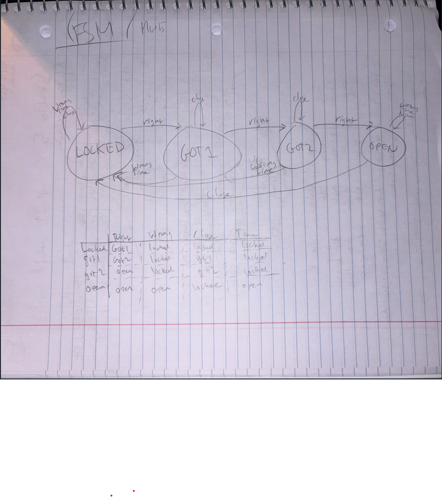

There are multiple ways to build and run this folder. "make" builds main.c, lock.c/.h, allowing entry in the command line via "./main data/codes.txt" (**must be done in this syntax to get the proper output**). Insert 'X' or 'x' to end the program in this state. "make run" builds/runs main.c and subsidiary files, allowing users to enter the code manually in the terminal. Doing it this way allows manual checking of the 5-second timeout implementation. "make test" builds/runs the test_lock.c test suite, and outputs passes/fails to the terminal. "make clean" removes all builds.

<table width="100%">
  <thead>
    <tr>
      <th></th>
      <th>E_RIGHT</th>
      <th>E_WRONG</th>
      <th>E_CLOSE</th>
      <th>E_TIMEOUT</th>
    </tr>
  </thead>
  <tbody>
    <tr>
      <th>LOCKED</th>
      <td>GOT1</td>
      <td>LOCKED</td>
      <td>LOCKED</td>
      <td>LOCKED</td>
    </tr>
    <tr>
      <th>GOT1</th>
      <td>GOT2</td>
      <td>LOCKED</td>
      <td>GOT1</td>
      <td>LOCKED</td>
    </tr>
    <tr>
      <th>GOT2</th>
      <td>OPEN</td>
      <td>LOCKED</td>
      <td>GOT2</td>
      <td>LOCKED</td>
    </tr>
    <tr>
      <th>OPEN</th>
      <td>OPEN</td>
      <td>OPEN</td>
      <td>LOCKED</td>
      <td>OPEN</td>
    </tr>
  </tbody>
</table>

